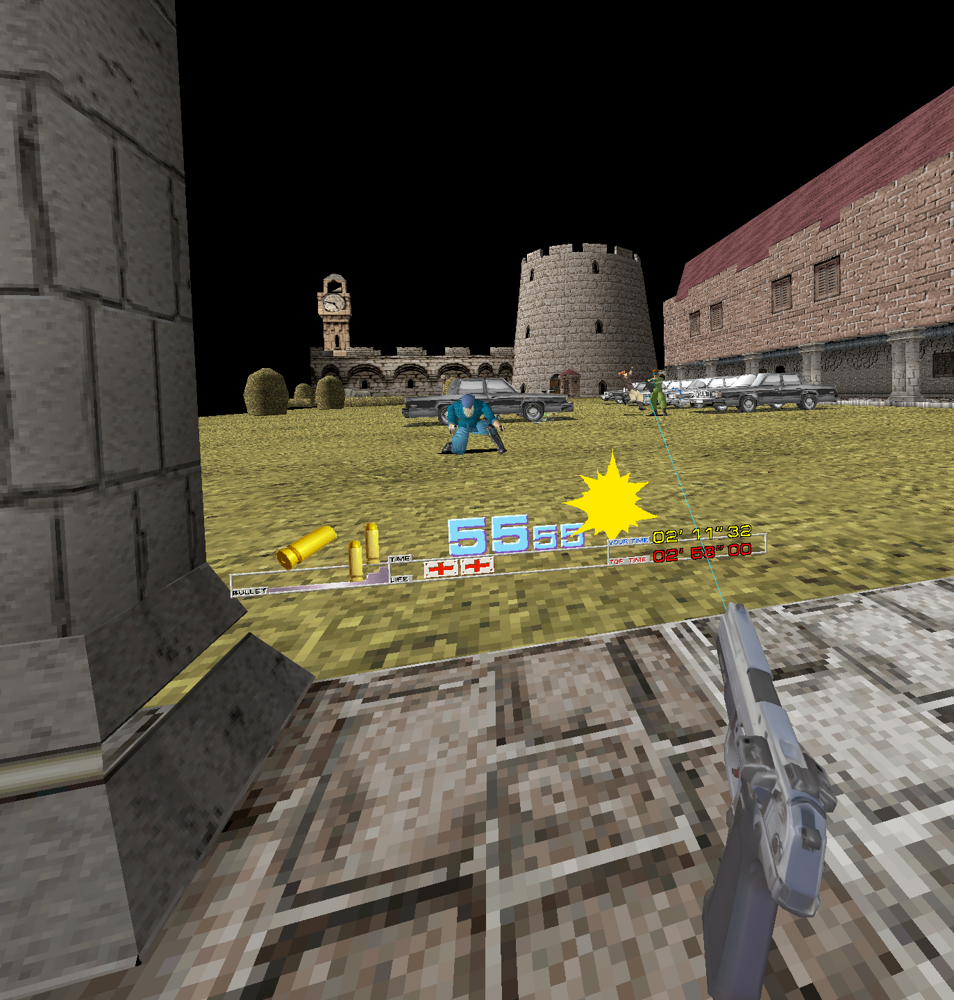
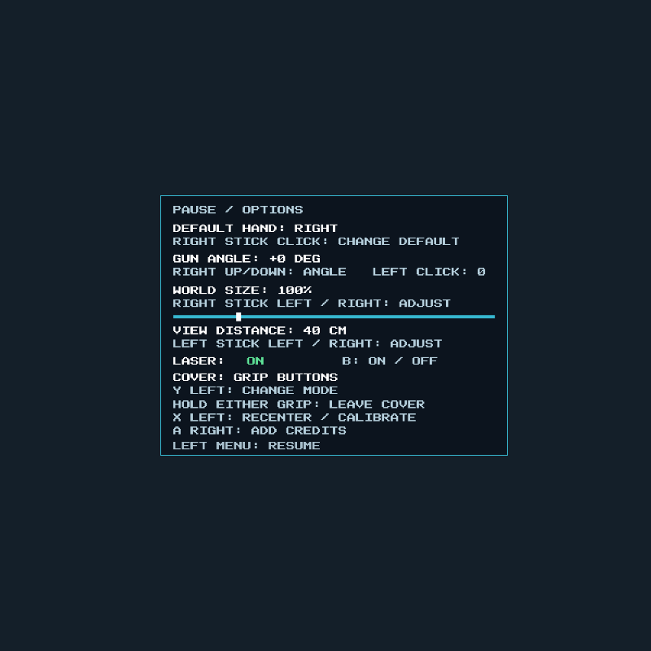

# Time Crisis VR for Meta Quest and Windows

An experimental VR port of **Time Crisis** for **Meta Quest** and **Windows PCVR**, with a tracked 3D pistol, stereo rendering, original arcade gameplay and sound, and a choice of physical ducking or grip-controlled cover. Tested on Quest 3; the APK also declares Quest 2 and Quest 3S compatibility. The Windows build includes a mouse-controlled monitor mode.

**Built on [spacestate1/namco22-decompile](https://github.com/spacestate1/namco22-decompile).** This project adds the Android/OpenXR host, Quest renderer, VR aiming, player weapon and controls to that reconstruction. The original arcade logic and shared engine come from upstream; this is not an independent recreation of the game.

[Downloads](https://github.com/DR-89/time-crisis-vr/releases) · [Quest quickstart](docs/QUICKSTART.md) · [Windows / PCVR](docs/PCVR.md) · [Technical notes](docs/DEVELOPMENT.md) · [Attribution](NOTICE.md)



*Actual app eye capture. The screenshot is from the 0.6.0 performance test; it is not a mockup.*

## Current status

**[v0.9.4](https://github.com/DR-89/time-crisis-vr/releases/tag/v0.9.4) — Quest ARM64 and Windows x64.** The default tracked weapon is now the blue Namco arcade
pistol, matching Time Crisis II VR and Crisis Zone VR. It uses the same calibrated
grip and muzzle, textured model and whole-gun recoil in both hands on Quest and
PCVR. The previous pistol remains a fallback. See the [release notes](docs/RELEASE_NOTES_0.9.4.md) and [weapon details](docs/WEAPONS.md).

The saved render-resolution presets, default-on texture filtering with an immediate ON/OFF switch, and Quest launcher icons and banners introduced in [v0.9.3](docs/RELEASE_NOTES_0.9.3.md) are retained.

**Quest upgrade from v0.8.4 or earlier: the APK signing key has changed.**
The original key was unavailable after restoring the project. This APK cannot
update the old signed installation in place. **Back up settings and EEPROM
before uninstalling**, then install the current APK and restore the backup. See the
[backup and migration instructions](docs/SIGNING-MIGRATION.md). Windows is unaffected.

Changes in v0.9.0:

- **WORLD SIZE: 25–400%**, in 5-point steps with the right stick left/right in options. The calibrated 100% starting point places a complete opening soldier at about 1.71 m and nearby cover at about 1.28 m.
- **VIEW DISTANCE: 0–100 cm**, in 5 cm steps with the left stick left/right. The default is 40 cm, giving nearby cover more clearance without shrinking figures.
- Head tracking, controller/gun size, HUD and physical-ducking thresholds stay in real metres. Original arcade simulation timing is retained.
- Restore your saved settings after the signing-key migration; later updates with the new key retain them. For a fresh comparison, use **100% / 40 cm** in a running level; use 0 cm for the original arcade-camera position.
- Automated tests cover stereo, surface aiming, impact placement, paused changes, settings and both hand layouts. The calibrated test build was exercised on Quest 3; a full-game and sustained-performance assessment remains pending.

The previous gun-angle controls and diagnostic exporter are retained. The reported chandelier/stairs crashes have not been reproduced; this release does not claim to fix them. See [report collection](docs/STAGE2-REPORTS.md). Quest 2/3S hardware tests and a new live PCVR check remain pending.

Changes in v0.8.4:

- Adjust **GUN ANGLE** from -60 to +60 degrees in 1-degree steps with the right stick while options are open; click the left stick to reset to zero.
- Negative angles lower the barrel. Model, muzzle, laser and shot direction use the same correction, saved for both hands. Existing settings are retained; the default angle is zero.
- Windows PCVR also accepts Up/Down and Home in options. Desktop mouse projection is unchanged.
- A diagnostic helper exports current/previous logs, input recordings and Android exit details to a ZIP. No diagnostics are uploaded automatically.

Changes in v0.8.3:

- Fix for off-centre aim/impact mismatch: the old flat layer used a 500 px focal length while the recorded arcade camera uses 772.5625 px, making the flat layer about 1.545 times too wide.
- Shot-mark sprites now use the nearest hit surface's depth, with an aligned flat-plane fallback. Other HUD sprites remain flat; normal desktop mouse projection is unchanged.
- Explicit Quest 2 manifest entry. Prefer 120 Hz when supported, otherwise the highest supported lower rate, such as 90 Hz. Confirm the actual rate and retry requests a bounded number of times after focus.
- Pixel-level projection tests pass, and the recorded Stage 1 session renders through 15,000 frames without CPU traps. See [camera alignment and refresh validation](docs/AIM-PROJECTION.md).

Changes in v0.8.2:

- New CC0 arcade pistol with a moving slide and trigger; recoil does not alter the aim ray.
- Either grip holds the virtual pedal. Both triggers select their controller and fire.
- Saved default hand keeps face-button roles stable during play. Physical ducking remains available.
- Corrected sRGB output prevents a second gamma encoding from washing out the arcade colours. The tester confirmed the improved appearance on Quest 3.

**Upgrading from v0.8.1:** cover has moved from the other controller's trigger to **either grip button**. Both triggers now select their own controller and fire. Existing laser, default-hand and physical-ducking preferences are preserved. The saved default hand controls the face-button layout; automatic handoffs do not swap those buttons.

Earlier builds established Quest gameplay, physical ducking and left-handed play. A Quest 3 connected through Virtual Desktop displayed stereo PCVR at 90 Hz on an RTX 3050 Laptop GPU, and the tester confirmed VR and controls worked. Those checks predate the v0.8.2 control changes. A complete playthrough and every boss/edge-case hit have not been verified.

Changes in v0.8.0:

- Native Windows OpenXR/OpenGL port, plus a desktop mouse mode.
- Arcade timing stays independent of compositor half-rate modes such as 45 Hz reprojection.
- Laser assistance is **on by default**; the weapon-hand upper button toggles it silently and saved choices are retained.
- Fix for the reproduced Stage 1 explosive-box exit: 318 omitted original instructions are translated at build time. The recorded failing session now passes frame 12,087 and runs through frame 15,000. See the [regression details](docs/CRASH-FIX.md).
- An infinite far plane prevents distant scenery from being clipped at the former 2 km limit. This addresses distant geometry loss; other missing-texture reports and geometry outside the original arcade camera still need testing.
- Current and previous session recordings/logs for reproducible bug reports.

The direct immersive Quest launcher fix from v0.7.3 is retained. Versions v0.7.1 and v0.7.2 could open as a flat panel.

The headset is asked to run at **120 Hz** when the runtime supports it, with a supported lower-rate fallback. This is a target, not a guarantee of perfectly stable 120 FPS. Quest 2's actual rate still needs a device measurement. See the measured results below.

## Download and install

1. Download **`TimeCrisisVR-v0.9.4-quest3.apk`** from [Releases](https://github.com/DR-89/time-crisis-vr/releases).
2. Enable developer mode on the Quest, connect it by USB and allow USB debugging.
3. Install the APK with SideQuest or Android platform-tools:

   ```sh
   adb install -r TimeCrisisVR-v0.9.4-quest3.apk
   ```

4. Open **Time Crisis VR (Experimental)** from the Quest library's **Unknown sources** section.
5. After the arcade startup, press **A on the right controller** (or **X** with the saved default hand set to LEFT), wait briefly for the three credits, then press **either trigger** to select that hand and start.

The bundled release APK includes the supplied Time Crisis ROM set and prepares it automatically on first start. **No separate ZIP selection or ROM import is required for that APK.** First startup can take a little longer while files are verified. Original game content is distinct from the MIT-licensed port code; see [NOTICE.md](NOTICE.md).

Updates signed with the same key retain settings and game data. **The v0.9.0 signing-key change requires the migration described above for v0.8.4 and earlier.** Uninstalling removes private app data, so keep a verified backup first. The APK remains debuggable for diagnostics; this is a sideload release, not a store release. The private signing key is not in the repository.

### Windows / PCVR

Extract **`TimeCrisisVR-v0.9.4-windows-x64.zip`** to a writable folder. Connect the
headset through your PC VR software, select an OpenXR runtime with OpenGL support,
then open **Play VR.cmd**. **Play SteamVR.cmd** selects an installed SteamVR runtime
for this launch only. **Play Desktop.cmd** starts mouse/keyboard play on a monitor.
Keep the complete extracted folder together. See [PCVR setup and controls](docs/PCVR.md).

### Optional ROM-free builds

The build tools can also create an APK without game files. Only for such a build, select your own **`timecris.zip` — Time Crisis World TS2 Ver.B** in the first-run setup screen. A matching ZIP can also be copied via USB:

```powershell
./Install-ROM.ps1 -Rom 'C:\path\to\timecris.zip'
```

The importer verifies every required chip by SHA-256 and accepts checksum-matching older chip names. Other regional/program revisions are not interchangeable. No ROM files are downloaded by the app. No extra BIOS file is required.

## Controls

**Render resolution:** open options with the **left menu button**, then use **left stick up/down** to find **GRAPHICS**. Move the **right stick left/right** to choose **Default**, **1280 x 1344**, **1680 x 1760**, **2550 x 2640**, **2940 x 3080** or **3360 x 3520** pixels per eye, matching the NFSU VR ports. Click the **left stick** to restore Default. Each change saves automatically; **fully close and restart the app** to apply it. The panel shows the active size and a restart reminder. Default preserves the previous resolution (runtime recommendation capped at 1440 pixels on the longer side on Quest, 2160 on PCVR). Unsupported presets fall back to Default. Higher resolutions require more GPU time and memory; the highest setting is not a performance recommendation. Texture filtering stays enabled by default and still switches immediately.

**Texture filtering:** open the VR options with the **left menu button**, then squeeze and release the **left grip** to switch **TEXTURE FILTERING: ON / OFF**. It defaults to **ON**, including when upgrading an older settings file, and saves automatically. Changes apply immediately; no restart is needed. This control uses the physical left controller in either handedness layout. During gameplay, grips still operate cover. Filtering smooths world textures; HUD and text retain their existing sampling.

| Action | Default hand: right | Default hand: left |
| --- | --- | --- |
| Aim the visible 3D pistol | Controller selected by its trigger | Controller selected by its trigger |
| Select weapon hand and fire / start / confirm | Either trigger | Either trigger |
| Insert three credits | A right | X left |
| Toggle laser silently, with no popup | B right | Y left |
| Pause and open options / resume | Left menu button | Left menu button |
| Set default hand, **in options** | Right thumbstick click | Right thumbstick click |
| Adjust world size, **in options** | Right stick left / right | Right stick left / right |
| Adjust view distance, **in options** | Left stick left / right | Left stick left / right |
| Adjust gun angle, **in options** | Right stick up / down | Right stick up / down |
| Reset gun angle, **in options** | Left thumbstick click | Left thumbstick click |
| Switch cover mode, **in options** | Y left | B right |
| Recenter and set upright head height | X left | A right |
| Grip cover: hold to leave cover; release both to hide/reload | Either grip button | Either grip button |
| Physical cover: hide/reload; leave cover | Duck; return upright | Duck; return upright |

**Weapon hand:** a fresh left trigger press moves the pistol to the left controller and fires; a fresh right trigger press does the same on the right. Aim and recoil vibration follow that controller. Holding both triggers does not repeatedly switch hands. After focus or tracking loss, release a trigger before firing again.

**Default hand and buttons:** open options and click the **right thumbstick** to change **DEFAULT HAND**. This saved preference determines the starting hand and the face-button layout in the table. Automatic trigger handoffs leave that layout unchanged. The left menu button always resumes play.

**Laser:** on by default, saved between sessions. A previous explicit off setting is retained. Turning it off hides only the beam; aiming and shooting still work.

**Gun angle:** open the left menu and move the right stick up
or down to adjust pitch in 1-degree steps, from -60 to +60 degrees. Hold the
stick to repeat. Negative values lower the barrel; if it points about 45 degrees
too high, try **-45 DEG**. Click the left stick to reset to zero. The setting is
saved and applies to both hands, rotating the model, muzzle, laser and shot
direction together. Zero preserves the original runtime aim pose. Recenter and
automatic hand switching retain your angle.

**World size:** open the left menu and move the **right stick left/right** to
adjust **WORLD SIZE** from **25% to 400%** in 5-point steps. Hold to repeat.
Higher values make the world larger. **100%** is the calibrated starting value:
a complete stage-one soldier measures about **1.7 m** in its firing pose and
the nearby cover about **1.28 m** high. Existing saved percentages are retained.
This is a physical VR scale: depth, stereoscopic depth cues and head-motion parallax
change together. At zero extra view distance, the centred angular framing stays
the same; use the separate view-distance control when cover fills too much of
the view.
The setting is saved automatically. Windows also accepts Left/Right;
End restores 100%. Head movement, controller/weapon size, HUD/menu size and
physical ducking distances stay in real metres. Target rays and world effects
follow the scaled scene, including changes made while paused.

**View distance:** open options and move the **left stick left/right** to adjust
**VIEW DISTANCE** from **0 to 100 cm**, in 5 cm steps. It starts at **40 cm**.
Increasing it moves the scene farther from you, so close cover occupies less
of your view while distant enemies change less. The gun, head tracking and HUD
keep their physical positions. Aim and impact marks follow the shifted scene.
The setting is saved; Windows also accepts Page Up/Page Down while paused.
Start calibration with WORLD SIZE 100% and VIEW DISTANCE 40 cm; use 0 cm to
restore the original arcade-camera position.

**Cover mode:** either grip button by default. Hold at least one to leave cover; release both to hide and reload. Open the left menu and press **Y** (right default hand) or **B** (left default hand) to switch between **PHYSICAL DUCKING** and **GRIP BUTTONS**. Cover mode can only change in options. The in-game menu and all documentation use English.

### Physical ducking

Choose physical ducking in the menu while upright. Press **X** (right-handed) or **A** (left-handed) while standing or sitting upright to calibrate your normal head height, then resume.

- Lowering your head by about **20 cm** enters cover and reloads.
- Returning to within **12 cm** of your calibrated height leaves cover.
- The gap between those thresholds prevents rapid switching from small movements.
- The recenter button recalibrates for a different standing/seated position. Height is recalibrated each app session; the selected mode is saved.
- Missing head tracking releases the virtual pedal. Cover input does not depend on the weapon controller being visible.



*Current world-size, view-distance and gun-angle controls, rendered from the production menu code in the desktop GLES fixture.*

## What the port includes

- Native Android/ARM64 app using **OpenXR and OpenGL ES**, running entirely on the headset.
- Native Windows x64 application using **OpenXR and OpenGL 4.3**, with stereo headset output, a PC mirror and an optional desktop mode.
- Separate eye poses/projections and head movement, with the original arcade camera progression.
- Tracked, textured player pistol, visual recoil and controller vibration.
- Original game logic, levels, textures, DSP and sound path supplied by upstream and the ROM set.
- Geometry-based controller aiming mapped to the original lightgun coordinates.
- Saved weapon hand, laser and cover preferences, pause, recenter and focus handling.
- A shared **multiview world pass**, bounded sprite image caching and faster sprite/text rasterization.
- Original game simulation at approximately **59.906 Hz**, with head and weapon poses updated at the headset refresh rate.

## Performance: measured, not promised

A two-minute active gameplay test of **v0.6.0** on Quest 3, with both controllers and the weapon rendered, recorded:

| Metric | Result |
| --- | --- |
| Requested / observed display rate | 120 Hz |
| Mean / median runtime FPS | 120.017 / 120 |
| Lowest one-second FPS sample | 115 |
| Repeated/late frames reported by runtime | 293 / 14,400 nominal frames — **2.035%** |
| Mean / p95 runtime CPU + GPU time | 5.21 / 6.84 ms |
| Per-eye render resolution | 1374 × 1440 |

One-second FPS counters can read slightly above 120 due to sample boundaries. They do not prove that every frame arrived on time. Short hitches remain, particularly on first loading or new textures. New textures may briefly appear coarser while the existing texture budget refines them. These results predate the menu/ducking/import changes and are **not a benchmark of v0.8.0 or PCVR**. See [performance details](docs/PERFORMANCE.md).

## Known limitations

- This is an experimental community port, not an official Namco or Meta release.
- No complete-game validation, and no guarantee of perfectly stable 120 FPS in every scene.
- The arcade game can discard geometry outside its original camera; unrestricted 360-degree viewing and roomscale traversal are not assured.
- Some sprites/HUD elements use a fixed-depth plane. World scale, stereo comfort and large sideways movements need broader testing.
- Original 2D hit logic still matters. All bosses, special targets and edge-of-screen hits have not been verified.
- The gun uses its own depth buffer and is drawn as a foreground model; level walls do not occlude it.
- No hand model or MSAA. Desktop operator/settings menus are not fully exposed in VR.
- Tested on **Quest 3**. Quest 2 and Quest 3S are declared in the manifest but have not been validated on hardware.
- PCVR initially targets Quest Touch controls and has been tested through Virtual Desktop. Other runtimes and controller profiles remain unverified.

## Build from source (Windows)

You need Git, CMake, Python 3 and a JDK. Android Studio's bundled JDK is detected at its usual Windows location; otherwise set `JAVA_HOME`. Building requires your own matching ROM set even for a ROM-free APK, because the DSP and sound translations are generated locally.

```powershell
git clone --recurse-submodules https://github.com/DR-89/time-crisis-vr.git
cd time-crisis-vr

# APK with your supplied ROMs; starts without an import step:
./Build-Quest.ps1 -Rom 'C:\path\to\timecris.zip' -BundleRoms

# Optional ROM-free APK:
./Build-Quest.ps1 -Rom 'C:\path\to\timecris.zip'

# Windows PCVR and desktop package:
./Build-PC.ps1 -Rom 'C:\path\to\timecris.zip'
```

Output:

- Bundled: `artifacts/bundled/TimeCrisisVR-with-ROM.apk`
- ROM-free: `artifacts/TimeCrisisVR-quest3-debug.apk`
- Build metadata and SHA-256: `build-info.json` beside the corresponding APK.
- Windows: `artifacts/pc/TimeCrisisVR-v0.9.4-windows-x64.zip` and its `.sha256` file.

The bootstrap downloads pinned NDK r27c, API 34, Build Tools 35.0.0, SDL 2.30.11, OpenXR loader 1.1.43 and Ninja 1.12.1 into `.tools/`. The first build takes several minutes and multiple GB. It does not install a global Android SDK. CMake and the JDK must already be installed.

The Windows build needs Git, CMake and Python 3; no Android SDK or JDK is required.
It downloads LLVM/MinGW 20260922, SDL 2.30.11, OpenXR loader 1.1.43, zlib 1.3.1 and
Ninja locally. The glad 2.0.8 OpenGL loader is included in source.

Upstream is pinned as a submodule at [`6aaa90b4`](https://github.com/spacestate1/namco22-decompile/tree/6aaa90b4cbc7a23733e1c9f5f9a5e772a19fe23d). `tools/patch_upstream.py` applies the guarded Quest adaptations reproducibly; generated game code and extracted ROMs stay out of this repository.

## Tests and diagnostics

See [DEVELOPMENT.md](docs/DEVELOPMENT.md) for the complete test and diagnostic workflow. Tests cover stereo/raycast math, exact GLES shaders, multiview image equivalence, sprite caching, 256 original-vs-optimized raster cases, saved options, physical-cover hysteresis and tracking loss, model rendering, ROM import and APK contents.

```powershell
./Test-Quest.ps1
python tests/test_options.py
python tests/test_handedness.py
python tests/test_world_scale.py
python tests/test_rasters.py
python tests/test_sprite_cache.py
python tests/test_patches.py
python tests/verify_apk.py
python tests/test_pc.py
./Export-Quest-Diagnostics.ps1
adb logcat -s TCVR TCVR-ROM SDL OpenXR
```

Tests that render through ANGLE currently use the ANGLE DLLs installed with VS Code on Windows and require MSVC. They do not emulate a Quest headset. Report bugs with the APK version, headset model, cover mode, scene and relevant log excerpts; do not attach ROMs or signing keys to issues.

## Support development

If you enjoy this project and would like to support further development of my VR ports, you can support my work on Patreon:

[https://www.patreon.com/c/OpenSourceDevDirk](https://www.patreon.com/c/OpenSourceDevDirk)

## Credits

The foundation is **[spacestate1/namco22-decompile](https://github.com/spacestate1/namco22-decompile)**, whose engine, translated game code, tooling and hardware reconstruction make this port possible. Please visit that repository for the original project and its other games.

Additional components: [SDL](https://github.com/libsdl-org/SDL), [Khronos OpenXR](https://github.com/KhronosGroup/OpenXR-SDK), [Martoscar's Namco Arcade Gun](https://sketchfab.com/3d-models/namco-arcade-gun-15fbd5b9add94a34b5c21746e3dd32be) (CC BY 4.0), and [FireWarden's CC0 Lowpoly Pistol](https://opengameart.org/content/lowpoly-pistol) as the animated fallback. Attribution, original copyright notices and the distinction between port code and original game content are documented in [NOTICE.md](NOTICE.md).
